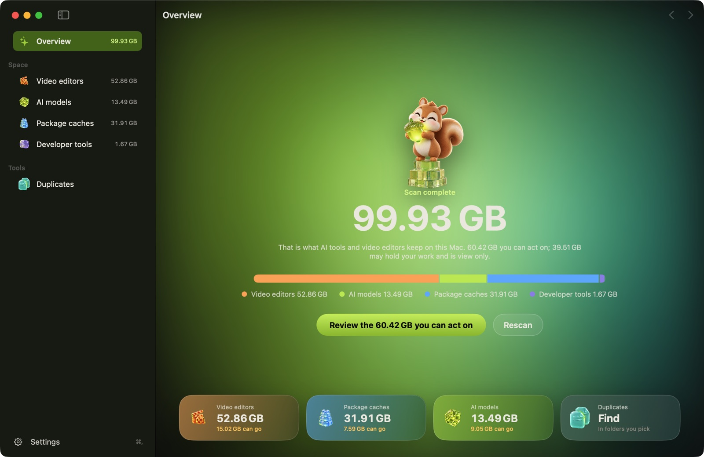
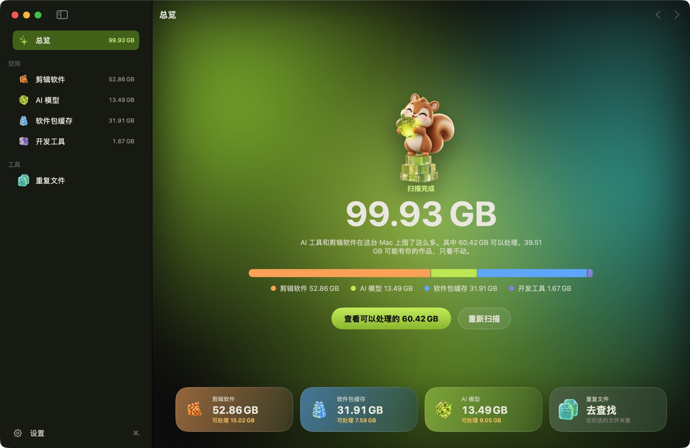
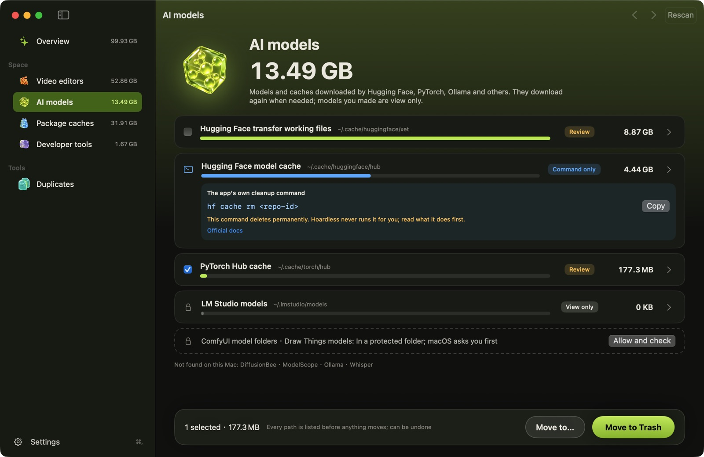

# Hoardless

**See what your AI tools are hoarding on your Mac — then move it or trash it, safely.**
**看清 AI 工具在你的 Mac 上囤了什么，再安全地挪走或丢进废纸篓。**

Free and open source (GPL-3.0). No account, no ads, no telemetry.
免费开源（GPL-3.0）。不用注册，没有广告，不收集任何数据。

中文界面 / Chinese interface

> **Status: in development.** The app works (scan, move or trash, duplicate finder). The first download will appear
> under [Releases](../../releases) when it is ready; until then you can [build it yourself](#build-from-source--自己编译).
>
> **当前状态：开发中。** App 已经能用（扫描、挪走或丢进废纸篓、查找重复文件）。第一个下载版准备好后会放在
> [Releases](../../releases) 页面；在那之前可以[自己编译](#build-from-source--自己编译)。

---

## Why / 为什么做

Local AI work fills a disk fast: model weights from Ollama, Hugging Face and LM Studio, Python package caches,
video-editor render caches. General Mac cleaners either skip these on purpose or treat them like junk.
Hoardless shows them clearly, explains what each one is, and lets you decide.

本地跑 AI 很快会把硬盘塞满：Ollama、Hugging Face、LM Studio 的模型，Python 包缓存，剪辑软件的渲染缓存。
通用清理工具要么故意跳过这些，要么当成垃圾一删了之。Hoardless 把它们列清楚、说明白，由你决定怎么处理。

## What it does / 功能

- **Show** disk usage, with AI models, package caches and video caches recognised by name.
  **看清**磁盘占用，自动认出 AI 模型、包缓存、剪辑缓存。
- **Find duplicates** (files of 1 MB or more with exactly the same content) in folders you pick. You tick the copies to send to the Trash; one copy of each file always stays. Copies inside an app's own data, a code repository or a Python environment are shown, never touched.
  **找重复**：在你选的文件夹里找内容完全相同、1 MB 以上的文件。由你勾选要丢进废纸篓的副本，每个文件至少留一份。应用自己的数据、代码仓库、Python 环境里的副本只显示，不动。
- **Move or trash** what you pick — to an external drive, an archive folder, or the Trash.
  **挪走或丢进废纸篓**：移到外置硬盘、归档文件夹，或废纸篓。

## Safety promises / 安全承诺

- Scanning only reads. Nothing is ever selected for you; every action asks first. / 扫描只读，从不替你勾选，每次操作都先问你。
- Hoardless itself never deletes permanently: files go to the Trash or a folder you choose (an external drive is fine). / Hoardless 自己从不永久删除：文件只进废纸篓，或挪到你指定的文件夹（外置硬盘也可以）。
- For a few apps, Hoardless only shows the app's own cleanup command instead of touching files. Those commands do delete permanently, so read what each one does before running it. / 少数应用 Hoardless 只给出它自带的清理命令，不直接动文件。这些命令会永久删除，运行前请先看清楚它做什么。
- Only looks at and cleans your home folder. No system folders, no admin password. / 只查看和清理你的用户目录，不碰系统目录，不要管理员密码。
- Anything that may hold your work is shown, never touched. / 可能有你作品的位置只显示大小，不做任何操作。

## Install / 下载安装

Needs macOS 14 or later, on an Apple silicon or Intel Mac. / 需要 macOS 14 或更新版本，Apple 芯片和 Intel 芯片的 Mac 都可以。

1. Download `Hoardless-<version>.dmg` from [Releases](../../releases). / 从 [Releases](../../releases) 下载 `Hoardless-<版本>.dmg`。
2. Open it and drag **Hoardless** into **Applications**. / 打开它，把 **Hoardless** 拖进"应用程序"。
3. Open Hoardless. If macOS says it can't check the app or can't open it, go to **System Settings → Privacy & Security**,
   scroll down and click **Open Anyway** next to Hoardless, then confirm.
   打开 Hoardless。如果 macOS 提示无法验证或无法打开，到"系统设置 → 隐私与安全性"，往下找到 Hoardless 旁边的"仍要打开"，点它并确认。

**Updates / 更新**: Hoardless never goes online, so it does not check for updates itself. To hear about new versions,
click **Watch → Custom → Releases** at the top of this page.
Hoardless 从不联网，所以不会自己检查更新。想收到新版本通知，在本页顶部点 **Watch → Custom → Releases**。

## Using it / 使用说明

1. Open Hoardless; it scans on its own (you can turn that off in Settings). Scanning only reads.
   打开 Hoardless 会自动扫描（可以在设置里关掉），扫描只读。
2. Pick a category on the left. Each row says what it is, how big it is and what happens if it goes:
   在左边选一个分类。每一行都写明它是什么、占多大、挪走后会怎样：
   - a tick box: you may move or trash it; / 有勾选框：可以挪走或丢进废纸篓；
   - **View only** (lock): it may hold your work, so Hoardless never touches it; / **只看**（锁）：可能有你的作品，Hoardless 不会动它；
   - **Command only**: the app has its own cleanup command, which Hoardless shows but never runs. / **只给命令**：应用有自带的清理命令，Hoardless 只显示，从不替你运行。
3. Tick what you want gone, then **Move to Trash** or **Move to…** (another folder or an external drive). Every path
   and size is listed before anything moves; after it, **Undo** puts it back.
   勾选要处理的，点"移到废纸篓"或"挪到…"（别的文件夹或外置硬盘）。动手前会列出全部路径和大小；做完后可以"撤销"放回去。
4. The space comes back once you empty the Trash. / 清空废纸篓之后，空间才真正腾出来。

**Duplicates / 重复文件**: pick folders, click **Find Duplicates**, tick the copies to remove. One copy of each file
always stays; copies in an app's own data, a code repository or a Python environment are never offered.
选好文件夹，点"开始查找"，勾选要删的副本。每个文件至少留一份；应用自己的数据、代码仓库、Python 环境里的副本不会让你勾。

**Permissions / 权限**: macOS may ask before Hoardless reads Documents, Desktop, Downloads, Movies or another app's
folder. Saying no only hides those sizes. Hoardless never asks for Full Disk Access or an admin password.
读取文稿、桌面、下载、影片或其他应用的文件夹前，macOS 可能会弹窗询问。拒绝的话只是看不到那部分的大小。Hoardless 不需要"完全磁盘访问权限"，也不要管理员密码。

**Privacy / 隐私**: no network access at all — no account, no analytics, no update check.
完全不联网：没有账号，不做统计，也不检查更新。

## Uninstall / 卸载

Quit Hoardless and drag it from **Applications** to the Trash. Its only other file is its settings,
`~/Library/Preferences/io.github.manson341349-beep.hoardless.plist`, which you can trash too. Anything you moved with
**Move to…** stays in the `Hoardless` folder inside the folder you picked; it is yours.
退出 Hoardless，把它从"应用程序"拖到废纸篓。它只额外留下一个设置文件
`~/Library/Preferences/io.github.manson341349-beep.hoardless.plist`，也可以一起丢掉。用"挪到…"挪走的东西留在你选的文件夹里的
`Hoardless` 文件夹中，那是你的文件，不会被卸载带走。

## FAQ / 常见问题

- **Why is this view only? / 为什么这一项只能看？** It may hold something you made or can't download again (drafts, your own models, logins). / 里面可能有你做的东西或无法重新下载的内容（草稿、自己的模型、登录信息）。
- **Why only a command? / 为什么只给一条命令？** Some apps manage their cache themselves and say not to edit it by hand; their own command is the safe way. / 有些应用自己管理缓存，并且说明不要手动改，用它自带的命令才稳妥。
- **I trashed something but have no more space. / 丢进废纸篓了，空间没变多？** Empty the Trash. Some sizes also count files shared with other folders (hard links, APFS clones), so less may come back than shown. / 清空废纸篓。另外有些大小包含与别处共用的文件（硬链接、APFS 克隆），实际腾出的可能比显示的少。
- **Undo is gone; how do I get it back? / 撤销按钮没了，怎么找回？** Trashed items: open the Trash, right-click, **Put Back**. Moved items: drag them back from the `Hoardless` folder. / 丢进废纸篓的：打开废纸篓，右键"放回原处"。挪走的：从 `Hoardless` 文件夹里拖回去。
- **Can I quit while it is moving files? / 正在挪动时能退出吗？** Hoardless asks first. Moves to another drive copy and check everything before the original goes to the Trash, so quitting never loses the original. / Hoardless 会先问你。挪到另一个硬盘时会先复制并核对，原件最后才进废纸篓，所以中途退出不会丢原件。

## Build from source / 自己编译

On macOS 14 or later with Xcode 16 or later: `scripts/build_app.sh` writes `build/Hoardless.app` for both Apple silicon
and Intel (Xcode 26 or later adds the layered macOS 26 icon); `scripts/build_app.sh --install` also puts it in
`~/Applications`. Tests: `swift test`. Rule checks: see [docs/RULES.md](docs/RULES.md).

在 macOS 14 及以上、装了 Xcode 16 或更新版本的 Mac 上：运行 `scripts/build_app.sh` 会生成同时支持 Apple 芯片和 Intel 的
`build/Hoardless.app`（Xcode 26 或更新版本还会带上 macOS 26 的分层图标）；`scripts/build_app.sh --install` 会顺便装到
`~/Applications`。测试：`swift test`。规则校验见 [docs/RULES.md](docs/RULES.md)。

## Won't do / 不做的事

RAM "boosters", system-folder "junk", app uninstalling (for now), browser/privacy cleaning, startup-item managers, anything needing admin rights.
内存"加速"、系统目录"垃圾"清理、卸载应用（暂不做）、浏览器隐私清理、启动项管理、需要管理员权限的功能。

## Supported apps / 已收录的应用

| App / 应用 | What / 内容 | Level / 等级 |
|---|---|---|
| ComfyUI Desktop | ComfyUI model folders / ComfyUI 模型文件夹 | protected · 只看 |
| DiffusionBee | DiffusionBee data / DiffusionBee 数据 | protected · 只看 |
| Draw Things | Draw Things models / Draw Things 模型 | protected · 只看 |
| Hugging Face | Hugging Face model cache / Hugging Face 模型缓存 | review · 要重新下载 · command only / 只给命令 |
| Hugging Face | Hugging Face transfer working files / Hugging Face 传输工具的工作文件 | review · 要重新下载 |
| LM Studio | LM Studio models / LM Studio 模型 | protected · 只看 |
| ModelScope | ModelScope models / ModelScope 魔搭模型 | review · 要重新下载 |
| Ollama | Ollama models / Ollama 本地模型 | protected · 只看 |
| PyTorch | PyTorch Hub cache / PyTorch Hub 缓存 | review · 要重新下载 |
| Whisper | Whisper models / Whisper 语音模型 | review · 要重新下载 |
| conda | conda package cache / conda 包缓存 | review · 要重新下载 · command only / 只给命令 |
| Homebrew | Homebrew download cache / Homebrew 下载缓存 | review · 要重新下载 |
| npm | npm cache / npm 缓存 | review · 要重新下载 |
| pip | pip cache / pip 缓存 | review · 要重新下载 |
| pnpm | pnpm package store / pnpm 包仓库 | review · 要重新下载 · command only / 只给命令 |
| uv | uv cache / uv 缓存 | review · 要重新下载 · command only / 只给命令 |
| CapCut | CapCut downloaded materials and app data / CapCut 下载的素材和应用数据 | protected · 只看 |
| CapCut | CapCut rebuildable cache / CapCut 可重建的缓存 | review · 要重新下载 |
| CapCut | CapCut drafts / CapCut 草稿 | protected · 只看 |
| 剪映专业版 (JianyingPro) | JianyingPro downloaded materials and app data / 剪映专业版下载的素材和应用数据 | protected · 只看 |
| 剪映专业版 (JianyingPro) | JianyingPro rebuildable cache / 剪映专业版可重建的缓存 | review · 要重新下载 |
| 剪映专业版 (JianyingPro) | JianyingPro drafts / 剪映专业版草稿 | protected · 只看 |
| Docker Desktop | Docker Desktop disk / Docker Desktop 虚拟磁盘 | protected · 只看 |
| Playwright | Playwright browsers / Playwright 浏览器 | protected · 只看 |

Nothing is ever pre-selected. / 任何项目都不会默认勾选。

- **safe**: the app rebuilds it automatically. / 应用会自动重建。
- **review**: nothing of yours is lost, but it must be downloaded or rebuilt again. / 不会丢你的东西，但要重新下载或重建。
- **protected**: may hold your work; size only, no action. / 可能有你的作品，只显示大小，不做任何操作。
- **command only**: Hoardless shows the app's own cleanup command instead of touching files. / 只给出应用自带的清理命令，不直接动文件。

Rules live in [`rules/apps/`](rules/apps/). Missing an app? See [docs/RULES.md](docs/RULES.md) — one JSON file, no code.
规则在 [`rules/apps/`](rules/apps/)。缺了你用的应用？看 [docs/RULES.md](docs/RULES.md)，加一个 JSON 文件就行，不用写代码。

## Contributing and safety reports / 参与贡献与安全问题

Hoardless is maintained in spare time. Issues and pull requests are welcome, but replies are not guaranteed to be fast.
Rule fixes and new rules are the most helpful contributions: see [CONTRIBUTING.md](CONTRIBUTING.md).
If Hoardless ever moved, trashed or offered something it should not have, please report it privately as described in
[SECURITY.md](SECURITY.md).

这是业余维护的项目。欢迎提 Issue 和 PR，但回复不保证及时。最有帮助的贡献是修正或新增应用规则，见 [CONTRIBUTING.md](CONTRIBUTING.md)。
如果 Hoardless 挪走、丢掉或允许你勾选了不该动的东西，请按 [SECURITY.md](SECURITY.md) 私下报告。

## License / 许可证

Source code: [GPL-3.0](LICENSE). The mascot and icons in `Sources/Hoardless/Resources/Art` are not GPL; all rights
reserved, see [their license](Sources/Hoardless/Resources/Art/LICENSE.md).

源代码：[GPL-3.0](LICENSE)。`Sources/Hoardless/Resources/Art` 里的吉祥物和图标不属于 GPL，版权保留，见[素材版权说明](Sources/Hoardless/Resources/Art/LICENSE.md)。

## About / 关于作者

The author also runs XinYu AI ([xinyuai.app](https://xinyuai.app)). Hoardless is free and open source and does not depend
on any XinYu service. No sign-up or purchase needed.

作者同时运营 XinYu AI（[xinyuai.app](https://xinyuai.app)）。Hoardless 免费开源，不依赖心宇的任何服务，无需注册或购买。
